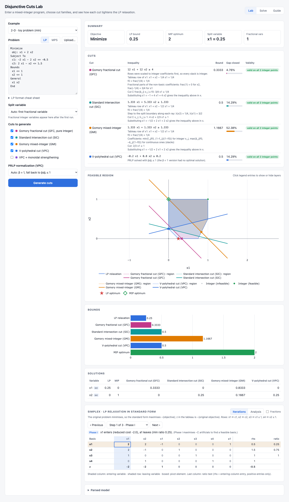
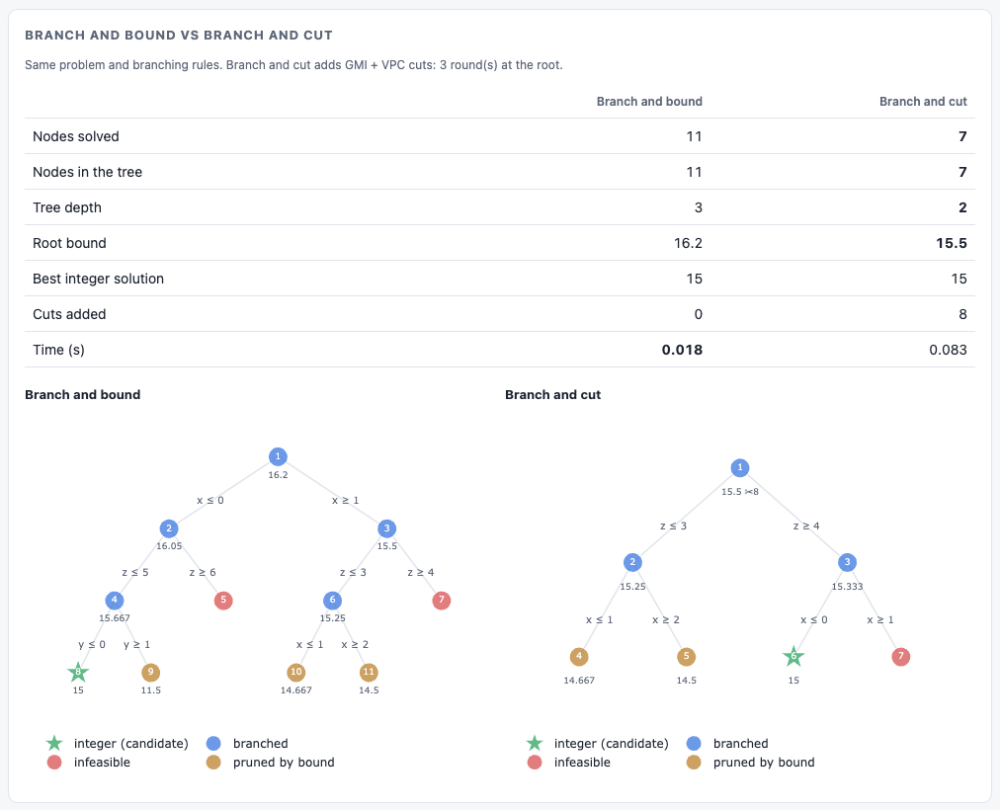

# Cutting Plane Lab

**New here? Read the [user guide](docs/USER_GUIDE.md)**: how to install and run the app, and how to use every tab, with screenshots.

A compact, readable implementation of **V-polyhedral disjunctive cuts (VPCs)**
for mixed-integer linear programs, with an optional **monoidal strengthening**
step, and with **Gomory fractional (GFC)**, **standard intersection (SIC)**
and **Gomory mixed-integer (GMI) cuts** for comparison, plus a **web
interface** that draws the feasible region and every cut for 2- and
3-variable problems. Built on [JuMP](https://jump.dev) and the open-source
[HiGHS](https://highs.dev) solver; the Julia package is called `CuttingPlane`.

Given a MIP, the code solves its LP relaxation, splits on a fractional integer
variable, describes each side of the split by a vertex and the rays of the LP
cone at that vertex, and solves a small *point-ray LP* (PRLP) to obtain a cut
`α'x ≥ β` that removes the LP optimum while keeping every integer-feasible point.
It then reports how much of the integrality gap the cut closes.

---

## Contents

- [User guide with screenshots](docs/USER_GUIDE.md)
- [Quick start](#quick-start)
- [Web interface](#web-interface)
- [Solve tab: iterative cutting planes, branch and bound, branch and cut](#solve-tab-iterative-methods)
- [Desktop app](#desktop-app)
- [Method](#method)
- [Repository layout](#repository-layout)
- [Usage](#usage)
- [Example output](#example-output)
- [API reference](#api-reference)
- [Assumptions and limitations](#assumptions-and-limitations)
- [Testing](#testing)
- [References](#references)

---

## Quick start

Requires **Julia ≥ 1.9** (developed with 1.11).

```bash
git clone https://github.com/mhmdamini/Cutting_Plane_Lab.git
cd Cutting_Plane_Lab
julia --project=. -e 'using Pkg; Pkg.instantiate()'   # install dependencies once
julia --project=. run.jl                               # command-line run on the built-in example
```

---

## Web interface

```bash
julia --project=app -e 'using Pkg; Pkg.instantiate()'  # once
julia --project=app app/server.jl                       # then open http://127.0.0.1:8000
```



The [user guide](docs/USER_GUIDE.md) walks through each tab (Lab, Solve, Guide) with screenshots.

Use `PORT=9000 julia --project=app app/server.jl` to pick another port. In
this mode the page loads [Plotly](https://plotly.com/javascript/) from its
CDN, so the browser needs internet access. The [desktop app](#desktop-app)
bundles Plotly and works offline.

In the interface you can:

1. **Enter a problem.** Type it in [CPLEX LP format](#lp-format), paste or
   upload an `.lp`/`.mps` file, or start from one of the built-in 2-D and 3-D
   examples.
2. **Choose the split variable.** By default the first fractional integer
   variable is used; after the first run, all fractional variables are listed.
3. **Choose the cut families.** GFC, SIC, GMI, VPC, and VPC with monoidal
   strengthening. You can also choose how the PRLP is normalized.
4. **Inspect the results:**
   - each cut's inequality, the new bound and the percentage of the gap closed;
   - a **validity check** of each cut against every feasible integer point
     (for 2-D and 3-D problems);
   - an interactive **feasible-region plot** for 2 or 3 variables, showing the LP
     relaxation, the integer points, the integer hull, the LP and MIP optima,
     each cut's line or plane, the region left after each cut, and its new
     optimum;
   - a **bounds chart** comparing the LP relaxation, each cut and the MIP optimum;
   - variable values for every solution, and the parsed model;
   - a **Simplex** panel for the LP relaxation in standard form (see below);
   - the **derivation** of every tableau cut (GFC, SIC, GMI) under its
     inequality: source row, f0, fractional parts or step lengths, the cut in
     the non-basic variables, and the slack substitution.
5. **Read the Guide.** The *Guide* tab, top right, explains every step and
   every method, how to read the results, and how to call each function from
   Julia.

### Simplex panel

- **Iterations:** every tableau of a textbook two-phase simplex, one step at
  a time. Each step highlights the entering column, the leaving row and the
  boxed pivot, shows the ratio test, and says why the pivot was chosen.
  Phase I (artificial variables) appears whenever some right-hand side is
  negative.
- **Analysis:** the optimal tableau built from the solver's basis, with the
  checks below and an explanation of every variable and constraint:
  - each variable's value, reduced cost and meaning, for example "raising it
    by 1 lowers z by 1/2";
  - each constraint's slack, whether it is binding, and its shadow price;
  - notes on degenerate vertices and alternative optima.
- **Fractions:** a toggle that shows values as exact fractions (`−1/2`) rather
  than decimals.

The checks verify the simplex independently on every run:

| Check | What it confirms |
|-------|------------------|
| `B⁻¹b ≥ 0` | the basis is primal feasible |
| reduced costs ≥ 0 | the basis is optimal (maximisation) |
| basic columns = identity | the tableau is consistent |
| values and objective = solver's | the tableau reproduces HiGHS's solution |
| `c_B'B⁻¹` = solver's shadow prices | the duals are right |
| textbook simplex reaches the same optimum | an independent algorithm agrees |

### LP format

```
Maximize            (or Minimize)
 obj: 5 x + 4 y
Subject To
 labor:    6 x + 4 y <= 24.5
 material: x + 2 y <= 6.5
Bounds              (optional; default is 0 <= var < +inf)
 x <= 3
General             (integer variables)
 x y
End
```

---

## Solve tab: iterative methods

The **Solve** tab runs complete algorithms on the problem in the Lab editor.
They are also available as library functions:

| Algorithm | What it does | Julia |
|-----------|--------------|-------|
| Cutting planes, one family | Repeat: solve LP → add separating cuts of one family → re-solve, until the LP solution is integer (proven optimal), nothing separates, the bound stalls, or the round limit | `cutting_plane_loop(model; methods = [:gfc])` |
| Cutting planes, several families | Same loop; each round adds the cuts of every selected family | `cutting_plane_loop(model; methods = [:gmi, :vpc])` |
| Branch and bound | LP-based B&B; node selection (best bound / depth first / breadth first) and branching rule (most / first fractional); pruning by infeasibility, bound and integrality | `branch_and_bound(model; node_selection = :best_bound)` |
| Branch and cut | B&B plus cut rounds at the root (global cuts, added to every node) and optionally at every node (local cuts, kept for that subtree) | `branch_and_bound(model; cut_methods = [:gmi], root_cut_rounds = 3, node_cut_rounds = 1)` |

Options:
- **Cut on:** the first, the most, or every fractional variable per round.
- **Max rounds** and **max nodes.**
- **PRLP normalization** for VPC.

For pure-integer problems, every cut added by these methods is scaled to
integer coefficients and its right-hand side rounded up (Chvátal–Gomory
rounding). This is valid, slightly stronger, and keeps GFC exact in later
rounds.

The results show:
- **Status and summary:** proven optimal, stalled, or limit reached.
- **Convergence chart:** the LP bound per round, or the best bound and
  incumbent per node, against the MIP optimum from HiGHS.
- **Feasible region (2-D/3-D):** for cutting planes, a slider replays the
  rounds one by one; for branch and bound, the root cuts and every node's LP
  solution.
- **Interactive tree:** each node coloured by how it ended (branched,
  integer, infeasible, pruned by bound), with the branching constraint on
  each edge.
- **Round or node table.**

The tree has a **replay** (▶ Play, step buttons and a slider) that shows the
search node by node, and **Compare B&B and B&C** solves the problem both ways
and shows a comparison table and the two trees side by side:



The tests check that every B&B / branch-and-cut variant finds the HiGHS
optimum on five problems (pure integer, 0/1, mixed integer). They also check
that no cutting-plane run ever pushes the bound past the MIP optimum, which
would mean an invalid cut.

## Desktop app

The same interface also ships as a standalone app, **Disjunctive Cuts Lab**,
that opens in its own window. Users need **nothing installed**: Julia, the
packages, the HiGHS solver and Plotly are all bundled, and it works offline.

| Platform | File | Install |
|----------|------|---------|
| Windows | `Disjunctive-Cuts-Lab-<version>-win-x64.exe` | Run the installer. If SmartScreen warns, choose *More info → Run anyway*. |
| macOS (Apple Silicon) | `Disjunctive-Cuts-Lab-<version>-mac-arm64.dmg` | Drag the app to Applications. The first time, right-click it and choose *Open*. If macOS says the app is damaged, run `xattr -cr "/Applications/Disjunctive Cuts Lab.app"`. |

Download them from the repository's **Releases** page. The installers are
not code-signed, which is why Windows and macOS show the warnings above.
The download is a few hundred MB, and the app takes a few seconds to start.

### How it works

```
Disjunctive Cuts Lab (Electron window, desktop/main.js)
  │  picks a free local port, shows "Starting the solver…"
  ├─ starts  server/bin/cuts-server   ← app/ compiled with PackageCompiler
  │          (Julia + CuttingPlane + JuMP + HiGHS, serves the UI and /api/solve)
  └─ loads   http://127.0.0.1:<port>/ in the window; stops the solver on quit
```

### Building it

Installers are built by GitHub Actions
([`.github/workflows/desktop.yml`](.github/workflows/desktop.yml)) on
Windows and macOS runners. There are two ways to trigger it:

- **Release:** push a version tag (`git tag v0.1.0 && git push origin v0.1.0`).
  The installers are attached to a new GitHub release.
- **Test build:** use *Actions → Desktop app → Run workflow*. The installers
  appear as downloadable artifacts of the run.

To build locally for your own platform (needs Julia and Node.js):

```bash
julia --project=build -e 'using Pkg; Pkg.instantiate()'
julia --project=build build/build_server.jl    # compile the solver (20–40 min)
cd desktop && npm ci
npm start                                       # try it
npm run dist:mac                                # or dist:win → installer in desktop/dist/
```

While developing, `cd desktop && npm run start:dev` opens the window
straight from the Julia sources, with no compile step. This needs Julia on
your `PATH`.

---

## Method

The full pipeline lives in [`run.jl`](run.jl); each step maps to one function.

| # | Step | Function(s) |
|---|------|-------------|
| 1 | Solve the MIP (for reference) and its LP relaxation; get the LP optimum `ω`. | `optimize_model!`, `relax_model` |
| 2 | Pick an integer variable `x_k` with fractional value `x̄_k`. | `fractional_integer_variables` |
| 3 | Rewrite the relaxation in standard form `max c'x, Ax ≤ b, x ≥ 0`. | `create_standard_form_model` |
| 4 | Build the split disjunction `x_k ≤ ⌊x̄_k⌋ ∨ x_k ≥ ⌈x̄_k⌉` (two subproblems). | `create_disjunctive_subproblems` |
| 5 | For each side: add slacks (normal form), solve, build the optimal simplex tableau, read off the optimal vertex `p_t` and the cone rays `R_t`. | `process_subproblem` → `create_normal_form_model`, `generate_optimal_simplex_tableau`, `compute_rays` |
| 6 | Solve the PRLP for the cut `α'x ≥ β`. | `solve_prlp` |
| 7 | Add the cut to the relaxation, re-solve, report the percentage of the gap closed. | `add_cut`, `gap_closed` |
| 8 | *(Optional)* Strengthen the cut coefficients with monoidal strengthening. | `prepare_monoidal_data`, `monoidal_strengthening` |

`generate_cut(relaxed, k, integer_vars, method)` runs steps 3–8 in one call
for `method ∈ (:gfc, :sic, :gmi, :vpc, :vpc_mono)`; the web interface uses it.

### Simplex code

- `create_standard_form_model` writes the relaxation as `max c'x, Ax ≤ b,
  x ≥ 0`, with each row labelled by the constraint or bound it came from.
- `create_normal_form_model` adds one slack per row.
- `generate_optimal_simplex_tableau` rebuilds `B⁻¹A`, `B⁻¹b` and the reduced
  costs from the basis HiGHS reports. On degenerate vertices it completes
  that basis with slack columns so that it stays square and non-singular.
- `verify_optimal_tableau` checks the result against the optimality
  conditions and against HiGHS (the checks above).
- `tableau_simplex` is an independent textbook two-phase simplex with
  Bland's rule. The tests require it to reach the same optimum as HiGHS on
  Phase I problems, degenerate problems and Beale's cycling example, and to
  detect infeasible and unbounded LPs.

### Tableau cuts: GFC, SIC and GMI

Both use only the LP cone at the relaxation optimum `x̄`: one ray per
non-basic variable. Read the optimal-tableau row of the fractional basic
variable, `x_k + Σ ā_j x_j = b̄` with `f0 = frac(b̄)`. Along ray `j`, `x_k`
moves by `−ā_j` per unit step.

**Standard intersection cut** (`sic_cut`). Walk along each ray until `x_k`
reaches `⌊b̄⌋` or `⌈b̄⌉`, and pass the cut through those intersection points:

```
λ_j = f0 / ā_j          if ā_j > 0
λ_j = (1 − f0) / (−ā_j)  if ā_j < 0          cut:  Σ_j x_j / λ_j ≥ 1
λ_j = ∞                  if ā_j = 0
```

**Gomory fractional cut** (`gomory_fractional_cut`, Gomory 1958). For
**pure integer** problems only:

```
Σ_j frac(ā_j) x_j ≥ f0
```

It needs every non-basic variable, slacks included, to be integer. Each row
is therefore first multiplied by the smallest integer that makes its
coefficients and right-hand side integral, so that slacks are integer at
integer points. For example, `−2x₁ − 2x₂ ≤ −0.5` becomes `−4x₁ − 4x₂ ≤ −1`.
Problems with continuous variables are refused; use GMI for them.

**Gomory mixed-integer cut** (`gmi_cut`). Uses the same coefficients
`1/λ_j = max(ā_j/f0, −ā_j/(1 − f0))` for continuous variables, but strengthens
those of integer non-basic variables:

```
Σ_{j integer}    min(f_j/f0, (1 − f_j)/(1 − f0)) x_j
+ Σ_{j continuous} max(ā_j/f0, −ā_j/(1 − f0))     x_j  ≥ 1.
```

So **GMI is never weaker than SIC**, and the two coincide when every
non-basic variable is continuous. In both cuts the slacks are treated as
continuous, and the cut is finally stated in the original variables by
substituting `s = b − Ax`.

How the five families relate:

| Cut | Disjunction | Relaxation of each side | Strengthening |
|-----|-------------|-------------------------|---------------|
| GFC | rounding of one tableau row (pure integer only) | the LP cone at `x̄` | none |
| SIC | split on `x_k` | the LP cone at `x̄` | none |
| GMI | split on `x_k` | the LP cone at `x̄` | integer coefficients |
| VPC | split on `x_k` | each side's own optimal vertex and cone | none |
| VPC + monoidal | split on `x_k` | each side's own optimal vertex and cone | integer coefficients |

### Point-ray LP

Every point in the union of the two sides lies in `conv{p_t} + cone{R_t}`, so
any `(α, β)` satisfying

```
α'p_t ≥ β          for each side's vertex p_t
α'r   ≥ 0          for each ray r of each side
```

is a valid cut. Among those, the PRLP picks the one most violated at `ω`.
Two normalizations are available (`normalization` keyword of `solve_prlp`):

| Option | Formulation | Notes |
|--------|-------------|-------|
| `:beta` *(default)* | fix `β = 1`, minimize `α'ω` | Original formulation. Unbounded if a valid cut with `β = 0` separates `ω`; infeasible if every valid cut has `β ≤ 0`. |
| `:l1` | `β` free, `‖α‖₁ ≤ 1`, minimize `α'ω − β` | Always bounded; the most violated cut under ℓ1 scaling. |
| `:auto` | try `:beta`, fall back to `:l1` | Used by `run.jl`. |

### Gap closed

```
gap closed (%) = 100 · (z_cut − z_LP) / (z_IP − z_LP)
```

where `z_LP` is the LP bound, `z_IP` the MIP optimum and `z_cut` the LP bound
after adding the cut.

---

## Repository layout

```
Cutting_Plane_Julia/
├── Project.toml          # package metadata and dependencies
├── Manifest.toml         # exact dependency versions (reproducibility)
├── run.jl                # end-to-end pipeline script (start here)
├── app/                  # web interface: package CutsApp (own environment)
│   ├── Project.toml      #   HTTP, JSON3, JuMP + this package
│   ├── server.jl         #   development entry point (julia --project=app app/server.jl)
│   ├── src/CutsApp.jl    #   HTTP server, routes, julia_main for the compiled app
│   ├── src/api.jl        #   JSON API: parse → generate cuts → results (POST /api/solve)
│   ├── src/iterate.jl    #   JSON API of the Solve tab (POST /api/iterate)
│   ├── src/geometry.jl   #   vertex enumeration for the 2-D / 3-D plots
│   ├── index.html        #   single-page UI (Plotly)
│   └── precompile_app.jl #   warm-up workload compiled into the desktop app
├── build/
│   └── build_server.jl   # PackageCompiler: compile app/ into a standalone solver
├── desktop/              # Electron shell of the desktop app
│   ├── main.js           #   starts the solver, opens the window
│   ├── loading.html      #   splash screen while the solver starts
│   └── package.json      #   Electron + electron-builder (Windows .exe, macOS .dmg)
├── .github/workflows/
│   └── desktop.yml       # CI: build and release the installers
├── examples/
│   └── toy_model.jl      # 2-variable example MIP
├── src/
│   ├── CuttingPlane.jl   # module definition and exports
│   ├── utils.jl          # read / relax / solve / report helpers
│   ├── forms.jl          # standard-form and normal-form reformulations
│   ├── tableau.jl        # simplex tableaux, basis recovery, cone rays
│   ├── vpc.jl            # disjunctions, PRLP, cut generation
│   ├── monoidal.jl       # monoidal strengthening
│   ├── simplex.jl        # textbook two-phase simplex (iterations, cross-check)
│   ├── tableau_cuts.jl   # Gomory fractional, standard intersection and GMI cuts
│   ├── iterative.jl      # iterative cutting-plane loop (one or several families)
│   ├── branch.jl         # branch and bound / branch and cut
│   └── cuts.jl           # generate_cut: one entry point for all cut families
└── test/
    └── runtests.jl       # validity checks on the toy example
```

---

## Usage

### Command line

```bash
julia --project=. run.jl                       # built-in toy example
julia --project=. run.jl path/to/model.mps     # split on the first fractional integer variable
julia --project=. run.jl path/to/model.mps 3   # split on variable 3 (1-based, in file order)
```

Any format JuMP can read works (`.mps`, `.mps.gz`, `.lp`, `.mof.json`, …).

### As a library

```julia
using CuttingPlane, JuMP

model = read_model("model.mps")
relaxed = relax_model(model);  optimize_model!(relaxed)
ω, _ = get_variable_values(relaxed)

integer_vars = lp_matrix_data(model).integers
k = first(fractional_integer_variables(relaxed, integer_vars))

std = create_standard_form_model(relaxed)
sides, D0 = create_disjunctive_subproblems(std, k, integer_vars)
results = [process_subproblem(s) for s in sides]

_, α, β = solve_prlp(ω, [r.point for r in results], [r.rays for r in results];
                     normalization = :auto)
cut_model = add_cut(relaxed, α, β)
optimize_model!(cut_model)
```

Each call to `process_subproblem` also returns the initial and optimal simplex
tableaux as `DataFrame`s (`first_tableau`, `optimal_tableau`), which is handy
for inspecting or teaching the method.

### Choosing a solver

Every solving function takes an `optimizer` keyword (default `HiGHS.Optimizer`),
so any JuMP-compatible LP solver that reports basis status can be used:

```julia
using Gurobi
optimize_model!(model; optimizer = Gurobi.Optimizer)
```

---

## Example output

`julia --project=. run.jl` on the toy problem

```
min  x₁ + 2x₂
s.t. -2x₁ - 2x₂ ≤ -0.5
      2x₁ -  x₂ ≤  1.5
      x₁ ≤ 1,  x₂ ≤ 1,  x ∈ ℤ²₊
```

prints (abridged):

```
╔═══════════════╗
║ LP relaxation ║
╚═══════════════╝
  x[1] = 0.25
  x[2] = 0.0
LP bound: 0.25    MIP optimum: 2.0
Splitting on variable 1 (x[1] = 0.25)
PRLP with β = 1 has no optimal solution; using the ℓ1-normalised PRLP instead.

╔══════════════════╗
║ V-polyhedral cut ║
╚══════════════════╝
Added cut: cut : -0.2 x[1] + 0.8 x[2] ≥ 0.2
Bound with cut: 0.5    gap closed: 14.29%
```

---

## API reference

| Function | Description |
|----------|-------------|
| `read_model(path)` | Read a model from file. |
| `relax_model(model)` | Copy of the model with integrality removed. |
| `optimize_model!(model; optimizer, verbose)` | Attach a solver and solve. |
| `get_variable_values(model)` | `(values, names)` of all variables; errors if not optimal. |
| `retrieve_objective_values(model)` | `(objective_value, termination_status)`. |
| `gap_closed(z_cut, z_int, z_lp)` | Percentage of integrality gap closed. |
| `create_standard_form_model(model)` | `max c'x, Ax ≤ b, x ≥ 0` reformulation. |
| `create_normal_form_model(model)` | Adds one slack per row: `[A I][x; s] = b`. |
| `generate_first_simplex_tableau(m)` | Initial tableau (`DataFrame`). |
| `generate_optimal_simplex_tableau(m)` | Optimal tableau + basis info (named tuple). |
| `compute_rays(tableau, structural, nonbasic)` | Cone rays at the optimal vertex (one column per ray). |
| `find_fractional_elements(values)` | Fractional entries and their indices. |
| `fractional_integer_variables(relaxed, ints)` | Integer variables that are fractional at the LP optimum. |
| `create_disjunctive_subproblems(model, k, ints)` | The two sides of the split on `x_k`, plus their RHS `D0`. |
| `process_subproblem(side)` | Tableaux, rays, vertex and normal-form model for one side. |
| `solve_prlp(ω, points, rays; normalization)` | Point-ray LP → `(model, α, β)`. |
| `add_cut(model, α, β)` | Copy of the model with `α'x ≥ β` added. |
| `prepare_monoidal_data(sides, results, α)` | Row multipliers `U[t][i] = α'r` per side. |
| `monoidal_strengthening(sides, k, U, α, ints)` | Strengthened coefficients `α̃` (integer variables only). |
| `gomory_fractional_cut(std_model, k, ints)` | GFC (pure integer) → `(α, β, rescaled, derivation)`. |
| `integer_scaled_model(std_model)` | Rows scaled to integer coefficients (integer slacks). |
| `tableau_simplex(std_model)` | Textbook two-phase simplex; every tableau as a `SimplexStep`. |
| `verify_optimal_tableau(norm_model)` | Optimality and solver-consistency checks of the optimal tableau. |
| `sic_cut(std_model, k)` | Standard intersection cut from the split on `x_k` → `(α, β, λ, derivation)`. |
| `gmi_cut(std_model, k, ints)` | GMI cut from the tableau row of variable `k` → `(α, β, derivation)`. |
| `intersection_step_lengths(ā, f0)` | Step length along each cone ray to the split boundary. |
| `cutting_plane_loop(model; methods, max_rounds, split_rule)` | Iterative cutting planes → `(status, rounds, cuts, objective, x, …)`. |
| `branch_and_bound(model; node_selection, branching, cut_methods, root_cut_rounds, node_cut_rounds, max_nodes)` | Branch and bound / branch and cut → `(status, objective, x, nodes, history, …)`. |
| `separation_round!(lp, ints, methods)` | One round of cut generation on a solved LP. |
| `integer_variable_indices(model)` | Indices of the integer **and binary** variables. |
| `generate_cut(relaxed, k, ints, method)` | Any cut family (`:gfc`, `:sic`, `:gmi`, `:vpc`, `:vpc_mono`) → `(α, β, note)`. |

All functions have docstrings; in the REPL type `?solve_prlp`, etc.

---

## Assumptions and limitations

- **Non-negative variables.** The standard-form step assumes `x ≥ 0`; finite upper bounds and positive lower bounds are turned into rows.
- **One split, one cut.** A single cut is generated per run, from a single variable split. There is no multi-round cutting loop yet.
- **Dense linear algebra.** Tableaux are built with dense matrices and an explicit basis inverse, which is fine for teaching and small or medium instances but not for large MIPLIB models.
- **Basis from the solver.** The tableau is rebuilt from the basis status the solver reports, so the solver must support `VariableBasisStatus` and `ConstraintBasisStatus` (HiGHS, Gurobi, CPLEX, Clp, … do).
- **Infeasible split side.** If one side of the split is infeasible, the split row itself is the strongest cut, and `run.jl` stops with a message.
- **Monoidal strengthening covers split disjunctions only.** It follows
  Balas–Jeroslow: the multipliers `u_t` of each side are read off the cone rays
  at that side's optimal vertex, and the split row `x_k` is replaced by
  `π'x` with `π = e_k + μ` (μ integer, supported on integer variables), which
  gives `α̃_j = min_μ max(α_1j − u0_1 μ, α_2j + u0_2 μ)` for integer `j`.
  Coefficients of continuous variables and the right-hand side β are left
  unchanged. The derivation is written out at the top of `src/monoidal.jl`,
  and the tests check validity by enumeration on the toy model and on the 3-D
  example of the web interface.

---

## Testing

```bash
julia --project=. -e 'using Pkg; Pkg.test()'
```

The tests generate cuts (GFC, SIC, GMI, VPC and VPC with monoidal strengthening) on the toy model and on the 3-D knapsack-style example from the web interface, and check that each one:

- separates the LP optimum;
- is satisfied by every integer-feasible point (checked by enumeration);
- yields a bound between the LP bound and the MIP optimum.

They also check that:
- monoidal strengthening never weakens a VPC;
- GMI always tightens the bound at least as much as SIC;
- GFC refuses mixed-integer problems;
- the textbook two-phase simplex and the solver-based tableau agree, and pass
  every optimality check, on Phase I, degenerate and cycling-prone LPs; the
  simplex also detects infeasible and unbounded LPs.

---

## References

- E. Balas, *Disjunctive Programming*. Springer, 2018.
- E. Balas and R. G. Jeroslow, “Strengthening cuts for mixed integer programs,” *European Journal of Operational Research* 4 (1980) 224–234.
- E. Balas and A. M. Kazachkov, “V-polyhedral disjunctive cuts” (preprint on arXiv).
- M. Lubin et al., “JuMP 1.0: Recent improvements to a modeling language for mathematical optimization,” *Mathematical Programming Computation*, 2023.
