# Cutting Plane Lab: user guide

How to install, run and use the Cutting Plane Lab web interface, with a
screenshot of every tab. For the method and the Julia API, see the
[README](../README.md).

## Contents

1. [Install](#1-install)
2. [Run the app](#2-run-the-app)
3. [Lab tab: generate and compare cuts](#3-lab-tab-generate-and-compare-cuts)
4. [Solve tab: cutting planes, branch and bound, branch and cut](#4-solve-tab)
5. [Guide tab](#5-guide-tab)
6. [Command line and library use](#6-command-line-and-library-use)
7. [Tests](#7-tests)
8. [Troubleshooting](#8-troubleshooting)

---

## 1. Install

You need **Julia 1.9 or newer** (developed with 1.11). The easiest way to
install it is [juliaup](https://github.com/JuliaLang/juliaup):

```bash
curl -fsSL https://install.julialang.org | sh
```

Then clone the repository and install the dependencies once. The first
install takes a few minutes because JuMP and HiGHS are precompiled.

```bash
git clone https://github.com/mhmdamini/Cutting_Plane_Lab.git
cd Cutting_Plane_Lab
julia --project=. -e 'using Pkg; Pkg.instantiate()'     # the CuttingPlane package
julia --project=app -e 'using Pkg; Pkg.instantiate()'   # the web interface
```

## 2. Run the app

From the repository folder:

```bash
julia --project=app app/server.jl
```

When the terminal prints
`Disjunctive cuts interface running at http://127.0.0.1:8000`, open
<http://127.0.0.1:8000> in a browser. Stop the server with **Ctrl+C**.

To use another port, set `PORT`:

```bash
PORT=8003 julia --project=app app/server.jl
```

Notes:

- The server serves only your own machine (127.0.0.1).
- The page loads Plotly and KaTeX from a CDN, so the browser needs internet
  access. The solver itself runs locally.
- The first request after starting is slower (a few seconds) while Julia
  compiles. Later runs are fast.
- `app/index.html` is read from disk on every page load, so after editing it
  you only need to reload the browser, not restart the server.

The page has three tabs at the top right: **Lab**, **Solve** and **Guide**.

---

## 3. Lab tab: generate and compare cuts

The Lab tab generates one cut of each selected family from the LP optimum and
shows how much each one tightens the LP relaxation.

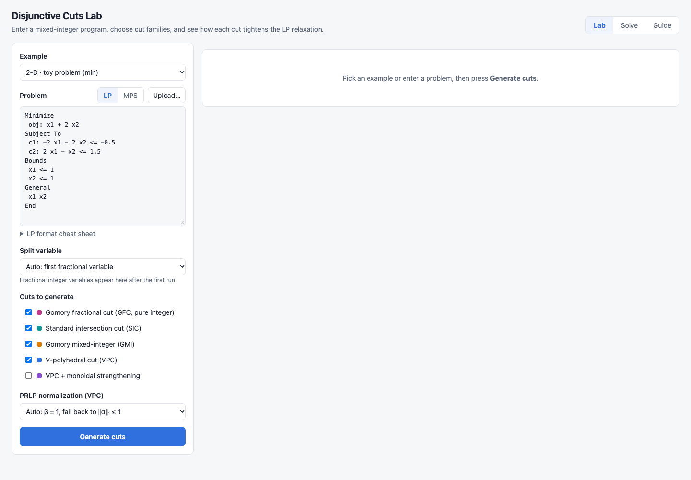

### Step by step

1. **Example.** Pick a built-in problem:
   - *2-D · toy problem (min)*
   - *2-D · roof*
   - *2-D · production planning*
   - *3-D · knapsack-style*

   Or type your own problem in the **Problem** box.
2. **Problem format.** **LP** (CPLEX LP format) or **MPS**. **Upload…** loads
   a `.lp`, `.mps` or `.txt` file. Open *LP format cheat sheet* for the
   syntax:

   ```
   Maximize            (or Minimize)
    obj: 3 x + 2 y
   Subject To
    c1: x + y <= 4.5
    c2: x - y >= -1
   Bounds              (default: 0 <= var)
    x <= 3
   General             (integer variables)
    x y
   End
   ```

   Every variable needs a lower bound of at least 0, and at least one
   variable must be integer.
3. **Split variable.** *Auto* splits on the first fractional integer
   variable. After the first run, every fractional variable is listed and you
   can pick one.
4. **Cuts to generate.** Tick any of:
   - Gomory fractional cut (GFC; pure-integer problems only)
   - Standard intersection cut (SIC)
   - Gomory mixed-integer cut (GMI)
   - V-polyhedral cut (VPC)
   - VPC with monoidal strengthening
5. **PRLP normalization (VPC).** *Auto* tries β = 1 first and falls back to
   ‖α‖₁ ≤ 1.
6. Click **Generate cuts**.

### Results


From top to bottom:

- **Summary.** The objective sense, the LP bound, the MIP optimum (from
  HiGHS), the split variable and the number of fractional variables.
- **Cuts.** One row per family:
  - the cut inequality and how it was derived from the tableau row;
  - the LP bound after adding it;
  - the *gap closed*, (bound with cut − LP bound) / (MIP optimum − LP bound);
  - a validity check against every integer point (for small problems).
- **Feasible region** (2 or 3 variables only). It shows the LP relaxation,
  each cut and the region it leaves, the integer points, and the LP and MIP
  optima. Click a legend entry to show or hide that layer.
- **Bounds.** A bar chart of the LP bound with each cut, against the MIP
  optimum.
- **Solutions.** The LP solution after each cut.
- **Simplex.** The LP relaxation in standard form (see below).
- **Parsed model.** The model as the code read it.

Feasible region, 2-D:

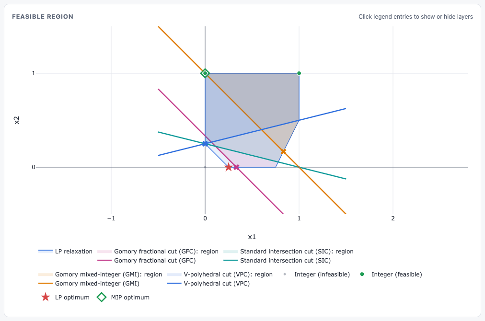

Three-variable problems are drawn in 3-D. Drag to rotate and scroll to zoom:

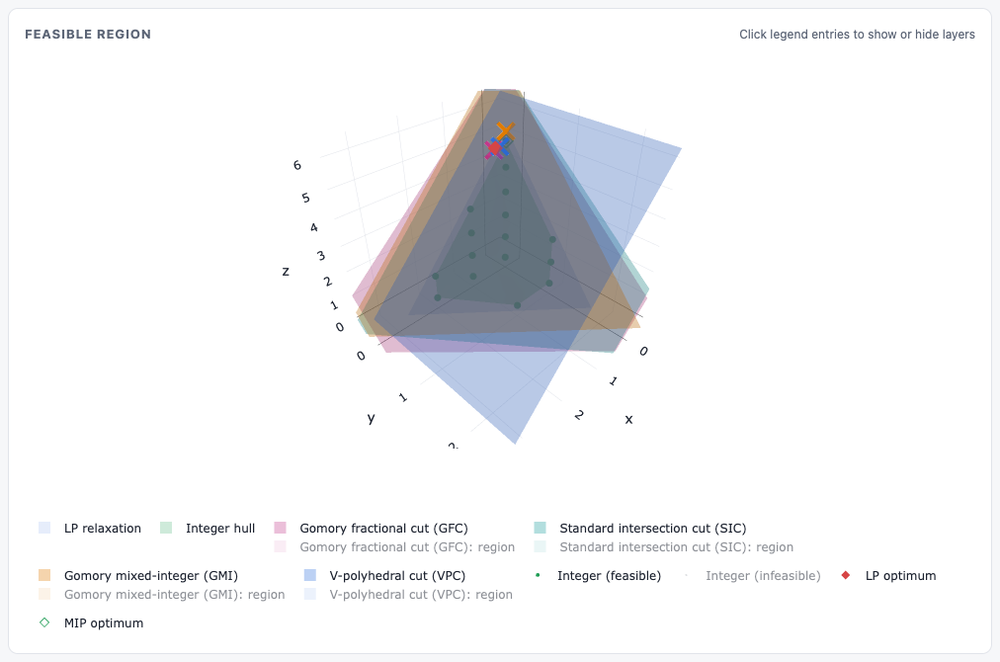

### Simplex panel

The **Iterations** sub-tab steps through the two-phase simplex method.
**‹ Previous** and **Next ›**, or the step menu, move between pivots. In each
step:

- the shaded column is the entering variable;
- the shaded row is the leaving variable;
- the boxed cell is the pivot;
- the last column is the ratio test.

Tick **Fractions** to show exact fractions instead of decimals.

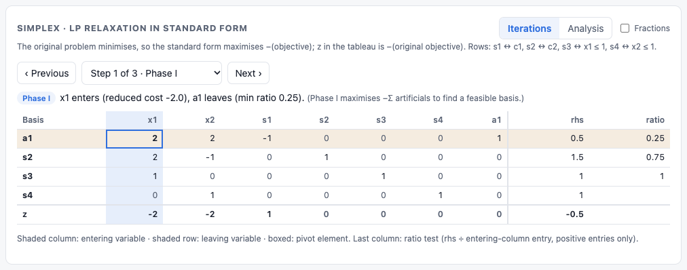

The **Analysis** sub-tab checks the optimal basis against the solver
(feasibility, optimality, identity columns, matching solution, objective and
shadow prices). It also lists every variable's value and reduced cost, and
every constraint's slack and shadow price.

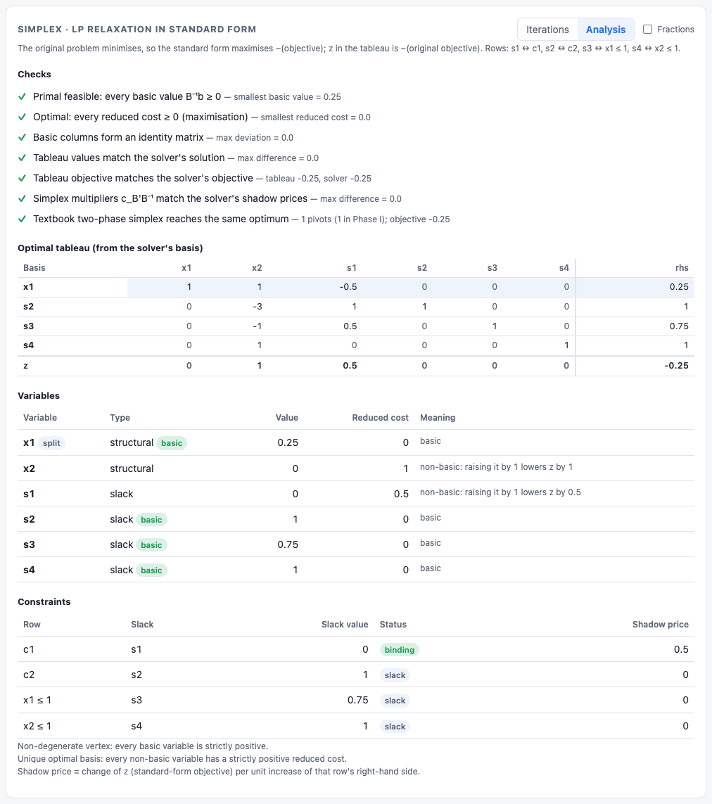

---

## 4. Solve tab

The Solve tab runs complete algorithms on the problem currently in the Lab
editor. To change the problem, use **Edit in the Lab tab →**.

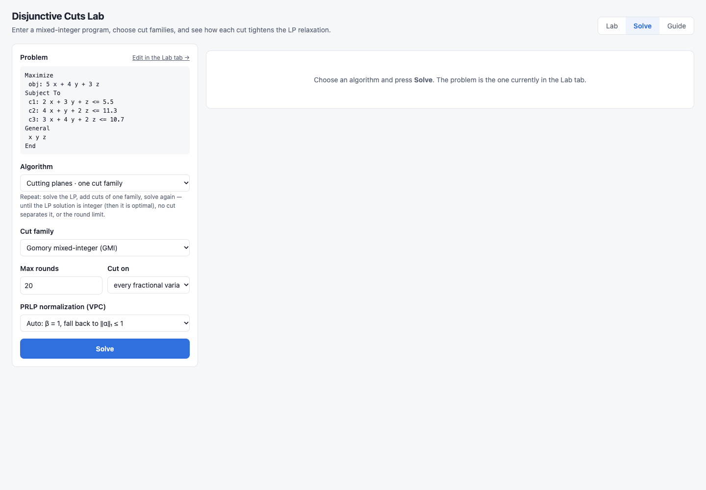

### Algorithms and options

| Algorithm | Options |
|-----------|---------|
| Cutting planes, one family | Cut family, **Max rounds**, **Cut on** (first, most, or every fractional variable), PRLP normalization |
| Cutting planes, several families together | Several families per round; other options as above |
| Branch and bound | **Node selection** (best bound, depth first, breadth first), **Branching variable** (most or first fractional), **Max nodes** |
| Branch and cut | As branch and bound, plus cut families, **root cut rounds** (global cuts) and **node cut rounds** (local cuts kept in that subtree) |

Click **Solve**.

### Cutting planes

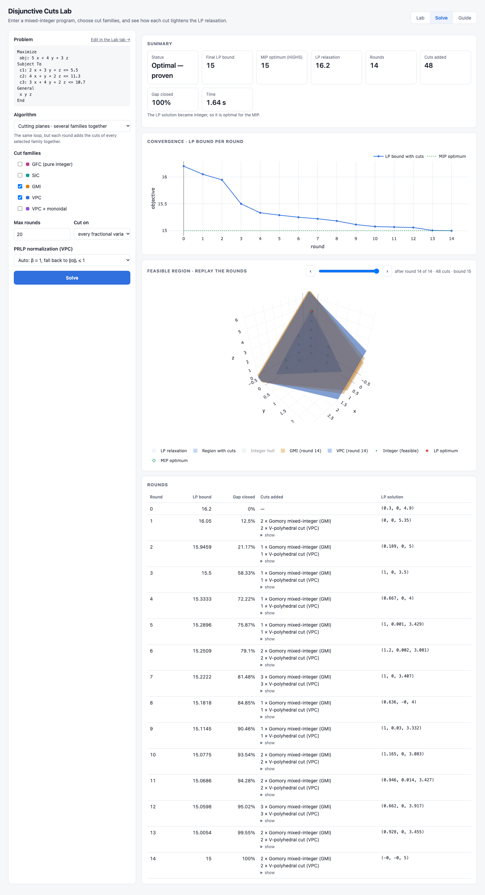

- **Summary.** The status (*Optimal — proven*, stalled, or limit reached),
  the final LP bound, the MIP optimum, the rounds, the cuts added, the gap
  closed and the time.
- **Convergence.** The LP bound per round against the MIP optimum.
- **Feasible region: replay the rounds.** Drag the slider, or use ‹ and ›,
  to see the region after each round.
- **Rounds.** A table of the bound, gap closed, cuts added (click *show* for
  the inequalities) and LP solution per round.

### Branch and bound

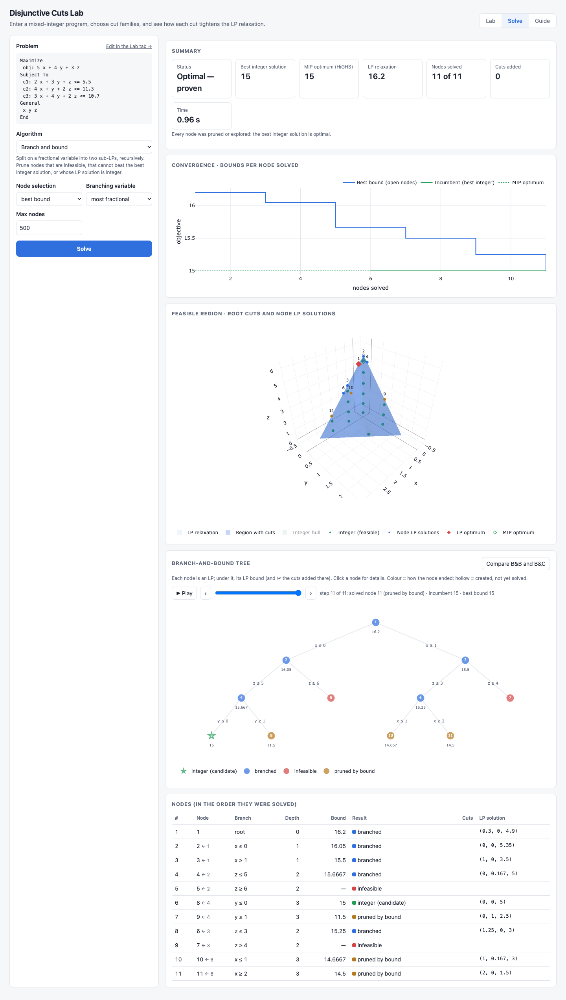

- **Convergence.** The best bound over open nodes and the incumbent (best
  integer solution) after each node solved.
- **Feasible region.** The root cuts and every node's LP solution, numbered.
- **Branch-and-bound tree.** Each circle is a node (an LP). The edge shows
  the branching constraint and the number under a node is its LP bound (✂ = the
  cuts added there). Colours show how a node ended:
  - blue: branched
  - green star: integer (candidate)
  - red: infeasible
  - brown: pruned by bound

  Click a node for its details.
- **Nodes.** A table of the nodes in the order they were solved.

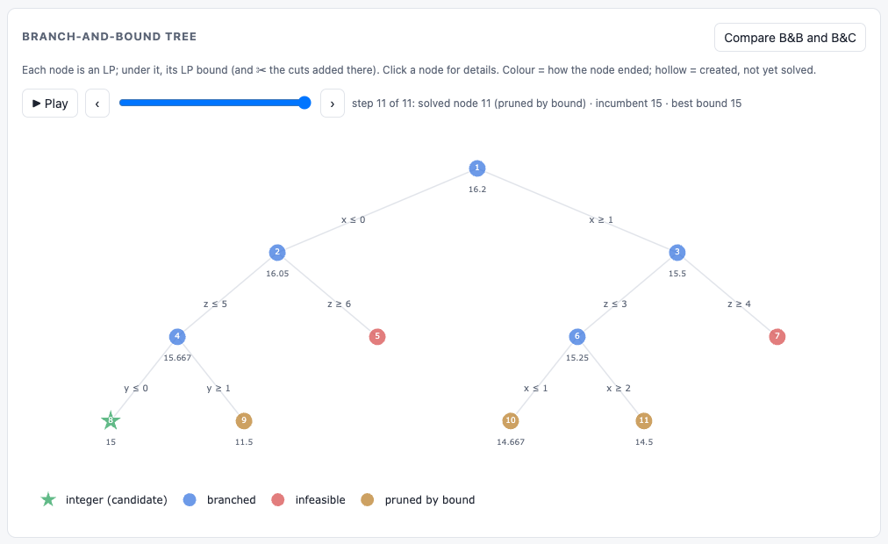

#### Replay the tree

Above the tree:

- **▶ Play** animates the search one node at a time.
- **‹** and **›** step backward and forward.
- The slider jumps to any step.

At each step:

- nodes created but not yet solved are hollow;
- the node just solved is ringed;
- the label gives the incumbent and best bound at that moment;
- a dotted line marks the same step on the convergence chart.

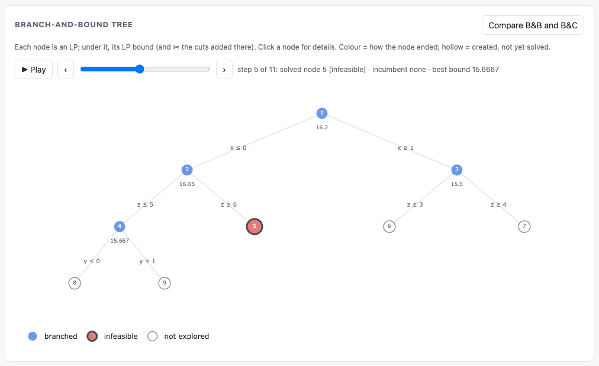

#### Compare branch and bound with branch and cut

Click **Compare B&B and B&C** (top right of the tree panel). It solves the
same problem with the same branching rules twice: plain branch and bound, and
branch and cut. Branch and cut uses the cut families ticked in the options
(GMI if none are ticked) with at least one root round. The table compares:

- nodes solved and in the tree;
- tree depth;
- root bound;
- best integer solution;
- cuts added;
- time.

The better value in each row is bold. The two trees are drawn side by side.


In this example, root cuts tighten the bound from 16.2 to 15.5, and the tree
shrinks from 11 nodes to 7.

### Branch and cut

The output is the same as for branch and bound. The root node shows the cuts
it added (✂), and the region plot shows the root cuts.

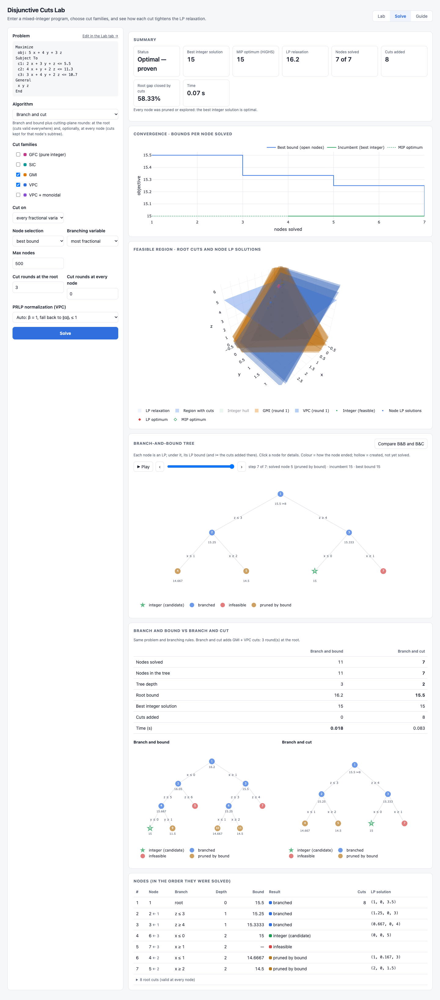

---

## 5. Guide tab

The Guide tab is the in-app manual. Its sections:

1. Getting started
2. Writing a problem
3. What happens when you click Generate
4. The simplex panel
5. Cut families (GFC, SIC, GMI, VPC, monoidal)
6. Reading the results
7. Solve tab
8. Using the Julia package
9. Function reference
10. Running the app
11. Glossary

Use the sidebar to jump to a section.

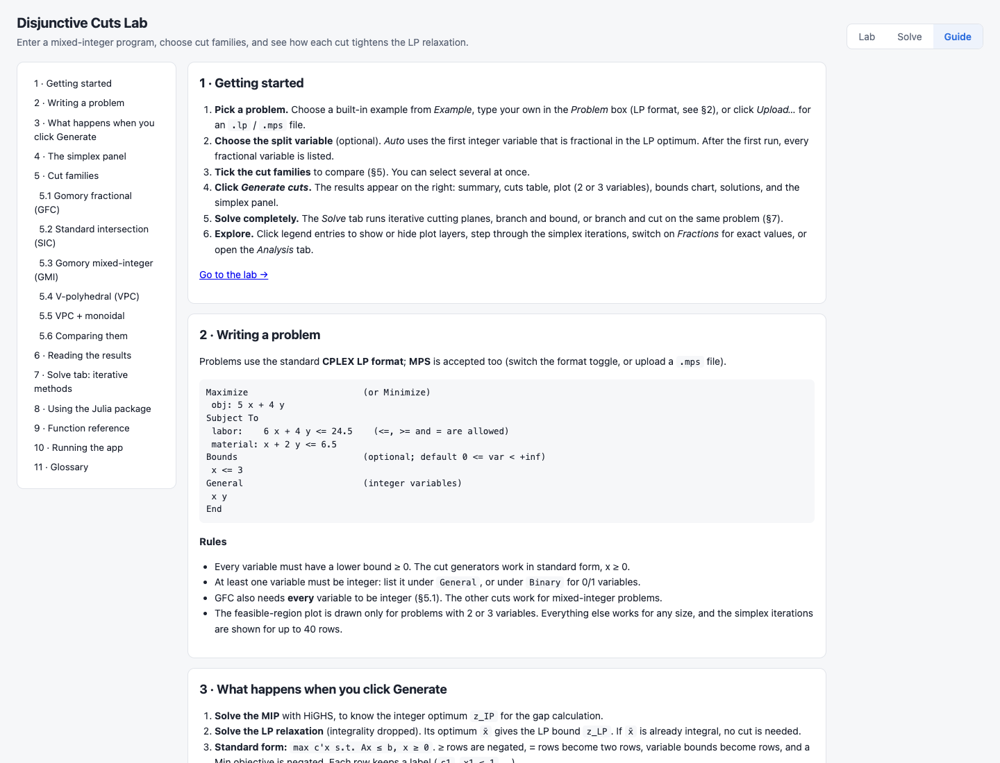

---

## 6. Command line and library use

Without the browser:

```bash
julia --project=. run.jl                       # built-in toy example
julia --project=. run.jl path/to/model.mps     # split on the first fractional integer variable
julia --project=. run.jl path/to/model.mps 3   # split on variable 3
```

The iterative methods are also library functions:

```julia
using CuttingPlane

model = read_model("model.mps")                # any .lp or .mps file

# Cutting planes
cutting_plane_loop(model; methods = [:gmi, :vpc])

# Branch and bound
branch_and_bound(model; node_selection = :best_bound)

# Branch and cut
branch_and_bound(model; cut_methods = [:gmi], root_cut_rounds = 3, node_cut_rounds = 1)
```

See [Usage](../README.md#usage) and [API reference](../README.md#api-reference)
in the README for single-cut generation and every function.

## 7. Tests

```bash
julia --project=. -e 'using Pkg; Pkg.test()'
```

## 8. Troubleshooting

| Problem | Fix |
|---------|-----|
| `address already in use` when starting the server | Another program is using the port. Start on another one, e.g. `PORT=8010 julia --project=app app/server.jl`. |
| Blank plots | Plotly loads from a CDN. Check the internet connection. |
| GFC reports an error | GFC applies to pure-integer problems only. Use SIC, GMI or VPC for mixed-integer problems. |
| No feasible-region plot | The plot is drawn only for problems with 2 or 3 variables. Everything else still works. |
| The first run is slow | Julia compiles on first use. Later runs in the same session are fast. |
| A changed `index.html` is not visible | Reload the page. Changes to `.jl` files need a server restart. |
